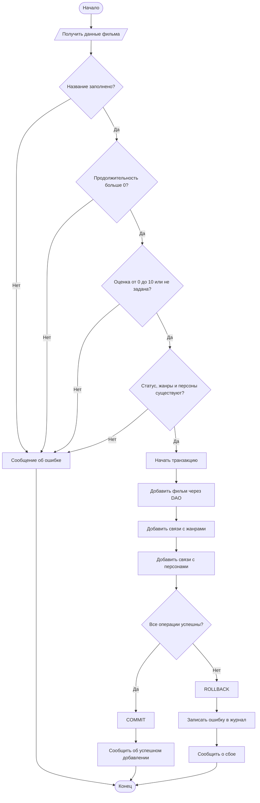
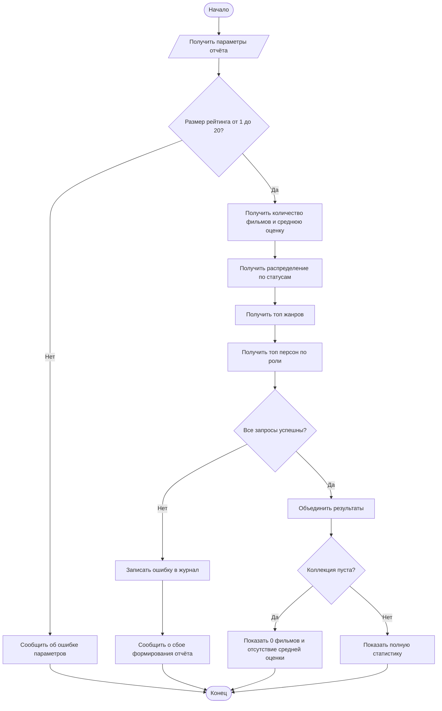

# Задание 5. Проектирование слоя бизнес-логики
**Проект:** «Менеджер личной коллекции (фильмы)»  
**Файл:** `docs/SERVICE_DESIGN.md`  
**Назначение документа:** описать бизнес-операции между интерфейсом приложения и DAO-слоем. Реализация программного кода в рамках задания не выполняется.

## 1. Обзор слоя бизнес-логики

Слой бизнес-логики (Service) принимает действия пользователя, проверяет бизнес-правила, вызывает один или несколько методов DAO, координирует связанные операции и возвращает интерфейсу понятный результат.

### 1.1. Границы ответственности

- **Интерфейс:** собирает данные и отображает результат.
- **Слой бизнес-логики:** проверяет входные значения и бизнес-правила, координирует DAO-вызовы, обрабатывает ошибки.
- **DAO:** выполняет SQL-запросы к SQLite и преобразует строки БД в объекты/результаты.
- **База данных:** хранит фильмы, статусы, жанры, персон и связи между фильмами, жанрами и персонами.

В документе используются таблицы предоставленной схемы `movies`, `statuses`, `persons`, `movie_persons`, `genres`, `movie_genres`. В таблице `movies` нет поля года выпуска, а роль персоны хранится в `movie_persons.role`. Предполагаемые методы DAO:

- `MovieDAO.getAll()`
- `MovieDAO.getById(id)`
- `MovieDAO.insert(movie)`
- `MovieDAO.update(movie)`
- `MovieDAO.delete(id)`
- `StatsDAO.getCollectionSummaryStats()`
- `StatsDAO.getTopMoviePersonsByRole(role, limit)`
- `StatsDAO.getMoviesDistributionByStatus()`
- `StatsDAO.getTopGenresReport(limit)`

Имена методов DAO ниже являются предполагаемыми: если в коде репозитория они называются иначе, нужно использовать фактические имена. В предоставленной схеме `movies.title` и `persons.full_name` не могут быть `NULL`, однако строку из одних пробелов необходимо отклонять на уровне бизнес-логики. При удалении фильма связи в `movie_genres` и `movie_persons` удаляются автоматически через `ON DELETE CASCADE`.

### 1.2. Общие правила

1. Строковые значения очищаются от пробелов по краям.
2. Обязательные поля не могут быть пустыми.
3. Продолжительность фильма должна быть положительным целым числом.
4. Оценка, если указана, должна находиться в диапазоне от `0` до `10`.
5. Статус должен существовать в таблице `statuses`.
6. Все указанные идентификаторы жанров и персон должны существовать.
7. Ошибка проверки не должна приводить к изменению БД.
8. Если операция состоит из нескольких записей/запросов, связанных одной пользовательской командой, изменения должны выполняться в одной транзакции.
9. Ошибки SQLite не показываются пользователю в виде технического traceback. Пользователь получает понятное сообщение, а подробности фиксируются в журнале приложения.
10. Внешние ключи SQLite должны быть включены для каждого соединения (`PRAGMA foreign_keys = ON`).

## 2. Описание бизнес-операций

Выбрано шесть операций. Они включают проверку условий, вычисления, координацию нескольких DAO-запросов и обработку ошибок.

---

## Операция 1. Добавление фильма в коллекцию

### Назначение

Добавляет фильм и при необходимости связывает его с выбранными жанрами и персонами. Это составная операция, поскольку запись фильма и записи связей должны сохраниться согласованно.

### Входные данные

- `title` — название фильма;
- `duration` — продолжительность в минутах;
- `rating` — оценка от 0 до 10 либо `NULL`;
- `status_id` — идентификатор статуса;
- `genre_ids` — список идентификаторов жанров (может быть пустым);
- `person_roles` — список пар «идентификатор персоны — роль» (может быть пустым).

### Результат

Идентификатор созданного фильма и сообщение об успешном добавлении. При ошибке — сообщение о причине, без частично сохранённых данных.

### Используемые DAO/SQL

- Проверка статуса: `SELECT id FROM statuses WHERE id = ?;`
- Проверка жанров: `SELECT id FROM genres WHERE id IN (...);`
- Проверка персон: `SELECT id FROM persons WHERE id IN (...);`
- Добавление фильма: `MovieDAO.insert(movie)` / `INSERT INTO movies (...) VALUES (...);`
- Добавление связей: `INSERT INTO movie_genres (...) VALUES (...);` и `INSERT INTO movie_persons (...) VALUES (...);`

Все значения передаются параметрами, а не конкатенируются в SQL-строку. Число плейсхолдеров в `IN` формируется по числу идентификаторов.

### Алгоритм (псевдокод)

```text
ФУНКЦИЯ addMovie(input):
    title := обрезать пробелы у input.title
    ЕСЛИ title пуст:
        вернуть ошибку "Введите название фильма"

    ЕСЛИ duration не целое число ИЛИ duration <= 0:
        вернуть ошибку "Продолжительность должна быть положительным целым числом"

    ЕСЛИ rating задан И (rating < 0 ИЛИ rating > 10):
        вернуть ошибку "Оценка должна быть от 0 до 10"

    проверить, что status_id существует
    проверить, что все genre_ids существуют
    проверить, что все person_ids существуют
    ЕСЛИ проверка не пройдена:
        вернуть ошибку без записи в БД

    НАЧАТЬ ТРАНЗАКЦИЮ
        movie_id := вставить фильм
        для каждого genre_id:
            вставить связь movie_genres(movie_id, genre_id)
        для каждой пары person_id, role:
            вставить связь movie_persons(movie_id, person_id, role)
    ЕСЛИ все действия успешны:
        ЗАФИКСИРОВАТЬ ТРАНЗАКЦИЮ
        вернуть movie_id и сообщение об успехе
    ИНАЧЕ:
        ОТКАТИТЬ ТРАНЗАКЦИЮ
        записать техническую ошибку в журнал
        вернуть "Не удалось добавить фильм. Данные не сохранены"
```

### Проверки и ошибки

- Пустое название, некорректная продолжительность или оценка — операция отклоняется до обращения к записи.
- Несуществующий статус, жанр или персона — операция отклоняется.
- Повторная связь, запрещённая ограничением `UNIQUE`, — транзакция откатывается.
- Ошибка SQLite/нарушение внешнего ключа — полный откат, фильм не должен остаться без запрошенных связей.
- Повторяющиеся ID в списках связей следует удалить до выполнения запросов либо отклонить как некорректный ввод.

### Тест-кейсы

**TC-1.1 — успешное добавление**

- Входные данные: название `Интерстеллар`, продолжительность `169`, оценка `8.7`, существующий статус, существующие жанры и персона.
- Ожидаемое поведение: все проверки пройдены; фильм и связи добавлены в одной транзакции.
- Ожидаемый результат: возвращён ID фильма; запись видна в каталоге, связи присутствуют в таблицах связей.

**TC-1.2 — некорректные данные**

- Входные данные: название из пробелов, продолжительность `0`, оценка `11`.
- Ожидаемое поведение: проверка завершается до записи.
- Ожидаемый результат: понятное сообщение об ошибке; количество фильмов и связей в БД не меняется.

**TC-1.3 — сбой при создании связи**

- Входные данные: корректный фильм и существующий жанр, но при вставке связи возникает ошибка БД.
- Ожидаемое поведение: транзакция откатывается.
- Ожидаемый результат: в БД не остаётся ни нового фильма, ни частично созданных связей; интерфейс получает сообщение о неудаче.

---

## Операция 2. Изменение данных фильма

### Назначение

Изменяет название, продолжительность, оценку и/или статус уже существующего фильма. При изменении статуса дополнительно проверяется, что такой статус существует.

### Входные данные

`movie_id` и новые значения полей фильма. Поля, которые пользователь не меняет, сохраняют прежние значения.

### Результат

Обновлённый фильм либо сообщение, что фильм не найден или входные данные некорректны.

### Используемые DAO/SQL

- Получение записи: `MovieDAO.getById(movie_id)` / `SELECT ... FROM movies WHERE id = ?;`
- Проверка статуса: `SELECT id FROM statuses WHERE id = ?;`
- Сохранение: `MovieDAO.update(movie)` / `UPDATE movies SET title = ?, duration = ?, rating = ?, status_id = ? WHERE id = ?;`

### Алгоритм

```text
ФУНКЦИЯ updateMovie(movie_id, changes):
    ЕСЛИ movie_id не положительное целое число:
        вернуть ошибку "Некорректный ID фильма"

    movie := MovieDAO.getById(movie_id)
    ЕСЛИ movie не найден:
        вернуть "Фильм не найден"

    объединить changes с текущими значениями movie
    проверить название, продолжительность и оценку
    ЕСЛИ status_id изменён:
        проверить существование нового статуса

    ЕСЛИ проверки не пройдены:
        вернуть ошибку без обновления

    выполнить MovieDAO.update(movie)
    ЕСЛИ БД сообщает об ошибке:
        вернуть "Не удалось обновить фильм"
    вернуть обновлённый фильм
```

### Проверки и ошибки

- ID должен быть положительным целым числом.
- Фильм должен существовать.
- Название не должно быть пустым; продолжительность должна быть больше нуля; оценка — в диапазоне `0..10` или `NULL`.
- Новый статус должен существовать.
- Если обновление завершилось ошибкой, интерфейс не должен сообщать об успехе.

### Тест-кейсы

**TC-2.1 — успешное изменение**

- Входные данные: существующий `movie_id`, новое название `Интерстеллар (режиссёрская версия)`, оценка `9.0`.
- Ожидаемое поведение: поля валидируются, DAO обновляет запись.
- Ожидаемый результат: новые значения сохранены и отображаются в каталоге.

**TC-2.2 — некорректная оценка**

- Входные данные: существующий ID, оценка `15`.
- Ожидаемое поведение: операция остановлена на проверке.
- Ожидаемый результат: запись остаётся без изменений; выводится сообщение о допустимом диапазоне оценки.

**TC-2.3 — фильм не найден / ошибка БД**

- Входные данные: ID `999999`, которого нет в БД; отдельно проверить сценарий сбоя SQLite.
- Ожидаемое поведение: отсутствие записи распознаётся до обновления; при сбое БД ошибка перехватывается.
- Ожидаемый результат: сообщение «Фильм не найден» либо «Не удалось обновить фильм»; приложение продолжает работать.

---

## Операция 3. Удаление фильма

### Назначение

Удаляет выбранный фильм и его связи с жанрами и персонами. Перед удалением требуется убедиться, что фильм существует.

### Входные данные

`movie_id` и подтверждение пользователя.

### Результат

Подтверждение удаления либо сообщение об отмене, отсутствии фильма или ошибке БД.

### Используемые DAO/SQL

- Проверка существования: `MovieDAO.getById(movie_id)`.
- Удаление: `MovieDAO.delete(movie_id)` / `DELETE FROM movies WHERE id = ?;`
- Связи в `movie_genres` и `movie_persons` удаляются автоматически благодаря `ON DELETE CASCADE` в предоставленной схеме.

### Алгоритм

```text
ФУНКЦИЯ deleteMovie(movie_id, confirmed):
    проверить корректность movie_id
    ЕСЛИ confirmed = false:
        вернуть "Удаление отменено"

    movie := MovieDAO.getById(movie_id)
    ЕСЛИ movie не найден:
        вернуть "Фильм не найден"

    НАЧАТЬ ТРАНЗАКЦИЮ
        удалить фильм через MovieDAO.delete(movie_id)
        SQLite автоматически удаляет связи через ON DELETE CASCADE
    ЕСЛИ успешно:
        ЗАФИКСИРОВАТЬ ТРАНЗАКЦИЮ
        вернуть "Фильм удалён"
    ИНАЧЕ:
        ОТКАТИТЬ ТРАНЗАКЦИЮ
        записать ошибку в журнал
        вернуть "Не удалось удалить фильм"
```

### Проверки и ошибки

- Не удалять запись без явного подтверждения пользователя.
- Несуществующий фильм не должен приводить к аварийному завершению.
- Если удаление запрещено внешним ключом, операция отменяется и пользователю сообщается, что запись не удалена.
- Ошибка во время удаления связей или фильма требует отката транзакции.

### Тест-кейсы

**TC-3.1 — успешное удаление**

- Входные данные: существующий ID, подтверждение `true`.
- Ожидаемое поведение: фильм и зависимые связи удаляются согласованно.
- Ожидаемый результат: фильм отсутствует в каталоге, осиротевших связей нет.

**TC-3.2 — отмена пользователем**

- Входные данные: существующий ID, подтверждение `false`.
- Ожидаемое поведение: DAO удаления не вызывается.
- Ожидаемый результат: фильм и все связи остаются в БД; отображается «Удаление отменено».

**TC-3.3 — запись отсутствует или БД недоступна**

- Входные данные: несуществующий ID; отдельно — имитация ошибки SQLite.
- Ожидаемое поведение: отсутствие записи обрабатывается как штатная ситуация; исключение БД перехватывается.
- Ожидаемый результат: сообщение «Фильм не найден» или «Не удалось удалить фильм», приложение продолжает работу.

---

## Операция 4. Поиск и фильтрация каталога

### Назначение

Возвращает список фильмов по поисковой строке и выбранным фильтрам: жанр, статус, минимальная/максимальная оценка и сортировка. Операция объединяет условия и параметры перед обращением к данным.

### Входные данные

- `query` — необязательная строка поиска;
- `genre_id` — необязательный идентификатор жанра;
- `status_id` — необязательный идентификатор статуса;
- `min_rating`, `max_rating` — необязательные границы оценки;
- `sort_by` — разрешённое поле сортировки: `title`, `rating` или `duration`;
- `sort_order` — `ASC` либо `DESC`.

### Результат

Список фильмов, соответствующих всем заданным условиям. Если совпадений нет — пустой список, а не ошибка.

### Используемые DAO/SQL

В предыдущем DAO-контракте `MovieDAO.getAll()` обеспечивает получение каталога. Если в DAO уже предусмотрен специализированный запрос поиска, использовать его. Иначе фильтрация может выполняться после получения списка, но предпочтительнее SQL-фильтрация при большом количестве записей.

Пример SQL для поиска по названию, статусу и оценке:

```sql
SELECT DISTINCT m.id, m.title, m.duration, m.rating, m.status_id
FROM movies AS m
LEFT JOIN movie_genres AS mg ON mg.movie_id = m.id
WHERE (? IS NULL OR m.title LIKE '%' || ? || '%' COLLATE NOCASE)
  AND (? IS NULL OR m.status_id = ?)
  AND (? IS NULL OR m.rating >= ?)
  AND (? IS NULL OR m.rating <= ?)
  AND (? IS NULL OR mg.genre_id = ?)
ORDER BY m.title ASC;
```

Каждый параметр передаётся отдельно. Сортировка по столбцу обычно не параметризуется как значение SQL, поэтому `sort_by` выбирается только из заранее заданного белого списка, а направление — только из `ASC`/`DESC`. В предоставленной схеме таблицы `movies` нет поля года выпуска, поэтому сортировка по году не поддерживается.

### Алгоритм

```text
ФУНКЦИЯ searchMovies(filters):
    очистить query от пробелов
    проверить min_rating и max_rating в диапазоне 0..10
    ЕСЛИ обе границы заданы И min_rating > max_rating:
        вернуть ошибку "Минимальная оценка больше максимальной"

    если genre_id задан:
        проверить существование жанра
    если status_id задан:
        проверить существование статуса
    проверить sort_by и sort_order по белому списку

    получить фильмы с применением фильтров
    если запрос завершился ошибкой БД:
        вернуть понятную ошибку
    если список пуст:
        вернуть пустой список и состояние "Ничего не найдено"
    вернуть список фильмов
```

### Проверки и ошибки

- Пустой поисковый запрос допустим: он означает отсутствие фильтра по названию.
- Оценки должны быть в пределах `0..10`; нижняя граница не должна превышать верхнюю.
- Несуществующие жанр/статус отклоняются либо сообщается, что фильтр недействителен.
- SQL-инъекция предотвращается параметризованными запросами и белым списком сортировки.
- Отсутствие совпадений — нормальный результат.
- При ошибке БД не возвращать ложный пустой список: интерфейс должен отличать ошибку от отсутствия результатов.

### Тест-кейсы

**TC-4.1 — поиск с результатами**

- Входные данные: `query = "Интерстеллар"`, остальные фильтры не заданы.
- Ожидаемое поведение: выполняется поиск без учёта регистра.
- Ожидаемый результат: возвращаются подходящие фильмы.

**TC-4.2 — некорректные фильтры**

- Входные данные: `min_rating = 9`, `max_rating = 5` либо `sort_order = "DROP TABLE"`.
- Ожидаемое поведение: проверка отклоняет параметры до выполнения запроса.
- Ожидаемый результат: сообщение о некорректных фильтрах; данные не изменяются.

**TC-4.3 — нет совпадений / ошибка БД**

- Входные данные: уникальная строка, которой нет в каталоге; отдельно — имитация сбоя SQLite.
- Ожидаемое поведение: первый сценарий возвращает пустой список, второй обрабатывается как ошибка.
- Ожидаемый результат: «Ничего не найдено» в первом случае; сообщение о сбое во втором, без аварийного завершения.

---

## Операция 5. Изменение статуса фильма

### Назначение

Переводит фильм в один из предусмотренных статусов коллекции: «В планах», «В процессе», «Завершено». Проверяет существование фильма и целевого статуса перед обновлением.

### Входные данные

`movie_id`, `new_status_id`.

### Результат

Обновлённая запись и сообщение об успехе либо сообщение об ошибке.

### Используемые DAO/SQL

```sql
SELECT id FROM movies WHERE id = ?;
SELECT id, name FROM statuses WHERE id = ?;
UPDATE movies SET status_id = ? WHERE id = ?;
```

Для обновления можно использовать `MovieDAO.getById()` и `MovieDAO.update()`, если отдельного метода DAO нет.

### Алгоритм

```text
ФУНКЦИЯ changeMovieStatus(movie_id, new_status_id):
    проверить, что оба ID являются положительными целыми числами
    movie := MovieDAO.getById(movie_id)
    ЕСЛИ movie не найден:
        вернуть "Фильм не найден"

    status := получить статус по new_status_id
    ЕСЛИ status не найден:
        вернуть "Выбранный статус не существует"

    ЕСЛИ movie.status_id = new_status_id:
        вернуть "Фильм уже имеет этот статус"

    movie.status_id := new_status_id
    выполнить MovieDAO.update(movie)
    при успехе вернуть новое состояние фильма
    при ошибке БД вернуть сообщение об ошибке
```

### Проверки и ошибки

- Фильм и целевой статус должны существовать.
- Статус выбирается из справочника, а не принимается произвольным текстом.
- Повторное назначение того же статуса не должно приводить к ошибке; можно вернуть информационное сообщение.
- При ошибке обновления старый статус сохраняется.

### Тест-кейсы

**TC-5.1 — смена статуса**

- Входные данные: существующий фильм со статусом «В планах», целевой статус «В процессе».
- Ожидаемое поведение: проверяются фильм и статус, выполняется обновление.
- Ожидаемый результат: статус фильма становится «В процессе».

**TC-5.2 — несуществующий статус**

- Входные данные: существующий фильм, `new_status_id = 999999`.
- Ожидаемое поведение: статус не найден, обновление не выполняется.
- Ожидаемый результат: сообщение об ошибке; старый статус не изменён.

**TC-5.3 — фильм отсутствует / ошибка SQLite**

- Входные данные: отсутствующий `movie_id`; отдельно — ошибка БД при `UPDATE`.
- Ожидаемое поведение: операция корректно обрабатывает оба сценария.
- Ожидаемый результат: «Фильм не найден» или сообщение о сбое; приложение не завершается аварийно.

---

## Операция 6. Формирование статистики коллекции

### Назначение

Формирует сводку о коллекции и отчёты по статусам, жанрам и персонам. Операция координирует несколько методов `StatsDAO` и объединяет результаты для одного экрана статистики.

### Входные данные

- `top_limit` — число элементов в рейтингах, целое число от 1 до 20;
- `person_role` — роль для рейтинга персон, если она поддерживается схемой (например, режиссёр или актёр).

### Результат

Объект/структура со сводной статистикой, распределением по статусам, топом жанров и топом персон.

### Используемые DAO/SQL

- `StatsDAO.getCollectionSummaryStats()` — общее количество фильмов и средняя оценка.
- `StatsDAO.getMoviesDistributionByStatus()` — количество фильмов по каждому статусу.
- `StatsDAO.getTopGenresReport(top_limit)` — наиболее часто встречающиеся жанры.
- `StatsDAO.getTopMoviePersonsByRole(person_role, top_limit)` — рейтинг персон по роли.

Примеры базовых SQL-запросов:

```sql
SELECT COUNT(*) AS total_movies, AVG(rating) AS average_rating
FROM movies;

SELECT s.name AS status_name, COUNT(m.id) AS movie_count
FROM statuses AS s
LEFT JOIN movies AS m ON m.status_id = s.id
GROUP BY s.id, s.name
ORDER BY s.name;

SELECT g.name AS genre_name, COUNT(mg.movie_id) AS movie_count
FROM genres AS g
LEFT JOIN movie_genres AS mg ON mg.genre_id = g.id
GROUP BY g.id, g.name
ORDER BY movie_count DESC
LIMIT ?;
```

В предоставленной схеме роль хранится непосредственно в `movie_persons.role`, поэтому запрос рейтинга персон фильтрует по этому полю. Используйте написание роли, совпадающее со значениями в БД, например `Режиссер`.

### Алгоритм

```text
ФУНКЦИЯ getCollectionStatistics(top_limit, person_role):
    ЕСЛИ top_limit не целое число ИЛИ top_limit < 1 ИЛИ top_limit > 20:
        вернуть ошибку "Размер рейтинга должен быть от 1 до 20"

    получить summary через StatsDAO.getCollectionSummaryStats()
    получить распределение статусов
    получить топ жанров с top_limit
    получить топ персон с person_role и top_limit

    ЕСЛИ любой запрос завершился ошибкой:
        записать технические детали в журнал
        вернуть "Не удалось сформировать статистику"

    объединить результаты
    если коллекция пуста:
        показать total_movies = 0 и average_rating = null/«нет оценок»
    вернуть сводный отчёт
```

### Проверки и ошибки

- `top_limit` — целое число от 1 до 20.
- Роль персоны должна быть одной из поддерживаемых проектом.
- Для пустой коллекции не возникает деления на ноль: `AVG` возвращает `NULL`.
- Если в категории нет данных, показывается нулевое количество или пустой рейтинг.
- Если один из DAO-запросов падает, отчёт нельзя выдавать как полностью успешный: пользователю сообщается об ошибке.
- Статистические запросы только читают данные и не должны изменять БД.

### Тест-кейсы

**TC-6.1 — коллекция содержит фильмы**

- Входные данные: `top_limit = 5`, допустимая роль персоны, в БД есть фильмы, жанры и статусы.
- Ожидаемое поведение: вызываются все четыре метода StatsDAO, результаты объединяются.
- Ожидаемый результат: показаны общее количество, средняя оценка, распределение по статусам, топ жанров и персон.

**TC-6.2 — некорректный размер рейтинга**

- Входные данные: `top_limit = 0` или `top_limit = 100`.
- Ожидаемое поведение: проверка отклоняет запрос до обращения к DAO.
- Ожидаемый результат: сообщение о допустимом диапазоне; SQL-запросы не выполняются.

**TC-6.3 — пустая коллекция / ошибка БД**

- Входные данные: база без фильмов; отдельно — ошибка при выполнении одного из статистических запросов.
- Ожидаемое поведение: пустая коллекция обрабатывается как корректное состояние; исключение БД обрабатывается отдельно.
- Ожидаемый результат: в первом случае количество фильмов равно `0`, средняя оценка обозначена как отсутствующая; во втором — сообщение «Не удалось сформировать статистику», приложение продолжает работу.

---

## 3. Общая стратегия обработки ошибок

| Ситуация | Действие слоя бизнес-логики | Результат для пользователя |
|---|---|---|
| Некорректные входные данные | Остановить операцию до записи/запроса | Сообщение с указанием поля |
| Фильм/жанр/статус/персона не найдены | Не продолжать зависимую операцию | Понятное сообщение «Запись не найдена» |
| Нарушение ограничения БД | Откатить транзакцию, если она открыта | Сообщение, что данные не сохранены |
| SQLite недоступна или запрос завершился ошибкой | Перехватить исключение, записать технические сведения в журнал | Нейтральное сообщение о сбое |
| Пустой результат поиска/статистики | Не считать это системной ошибкой | Показать пустой список или нулевую статистику |
| Пользователь отменил удаление | Не вызывать DAO удаления | «Удаление отменено» |

## 4. Требования к транзакциям

Транзакция обязательна для составных операций, изменяющих несколько таблиц:

- **Добавление фильма:** вставка в `movies` и создание связей в `movie_genres`/`movie_persons`.
- **Удаление фильма:** удаление самой записи; связанные строки удаляются автоматически через `ON DELETE CASCADE`.

При любой ошибке до фиксации транзакции выполняется `ROLLBACK`. При успешном завершении всех действий — `COMMIT`. Простые операции чтения и обновление одного фильма обычно не требуют отдельной бизнес-транзакции, если DAO уже гарантирует атомарность SQL-команды.

## 5. Связь бизнес-операций с DAO

| Бизнес-операция | Методы DAO | Изменяет БД |
|---|---|---|
| Добавление фильма | `getById` при необходимости; `insert`; SQL для связей | Да |
| Изменение фильма | `getById`, `update` | Да |
| Удаление фильма | `getById`, `delete`; удаление связей при необходимости | Да |
| Поиск и фильтрация | `getAll` или специализированный запрос выборки | Нет |
| Изменение статуса | `getById`, чтение `statuses`, `update` | Да |
| Статистика коллекции | четыре метода `StatsDAO` | Нет |

## 6. Критерии готовности

- Описано не менее четырёх нетривиальных бизнес-операций.
- Для каждой операции указаны назначение, входные данные, результат, DAO/SQL, алгоритм, проверки и обработка ошибок.
- Для каждой операции приведено не менее трёх тест-кейсов: успешный, с некорректным вводом и с отсутствующими данными/ошибкой БД.
- Для составных изменений предусмотрены транзакции и откат.
- Ввод пользователя не вставляется в SQL напрямую.
- Слой бизнес-логики не содержит деталей интерфейса и не выполняет SQL самостоятельно в обход DAO, за исключением приведённых в документе иллюстративных запросов.
- Файл размещён в репозитории по пути `docs/SERVICE_DESIGN.md`.


## 7. Блок-схемы операций

Диаграммы написаны на Mermaid внутри Markdown-блоков. GitHub отображает их непосредственно в предварительном просмотре файла `SERVICE_DESIGN.md`. Исходники также сохранены отдельно в `docs/diagrams/`.

### 7.1. Добавление фильма



Исходник: [`docs/diagrams/add_movie.mmd`](diagrams/add_movie.mmd).

### 7.2. Формирование статистики коллекции



Исходник: [`docs/diagrams/collection_statistics.mmd`](diagrams/collection_statistics.mmd). Статистические запросы читают данные; если они должны показывать согласованный снимок при параллельных изменениях, их можно выполнять в одной read-транзакции.
